# Healthy Hints: A Vision Agent with Google ADK

An AI agent that reads a photo of a packaged-food label and explains the ingredients. It uses **Gemini** to plan and reason, **Cloud Storage** to archive the image, and the **Cloud Vision API** to read the label text (OCR). Built with Google's **Agent Development Kit (ADK)**.

> Built as part of a graduate computer vision course (CS663, "Vision Agentic Computing"), starting from Google's [ADK multi-tool codelab](https://codelabs.developers.google.com/multi-tools-ai-agent-adk) and fixing a design flaw in its tool pipeline.

## What it does

You ask the agent about a label image by file name, for example:

> Analyze the ingredients in label_a.jpeg.

The agent then:

1. Calls `upload_image` to upload the photo to Cloud Storage under a unique name, and gets back its `gs://` URI.
2. Calls `read_ingredients` with **that exact URI** to run Vision OCR.
3. Explains each ingredient based only on the recognized text, notes when OCR looks incomplete, and avoids medical advice.

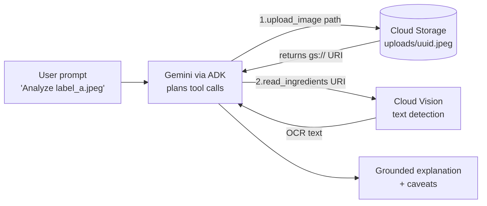

## The bug this fixes

In the original codelab, the two tools only looked connected:

| | Original codelab | This version |
|---|---|---|
| `upload_image` input | none (placeholder path) | the image the user names |
| `upload_image` output | nothing | unique `gs://` URI |
| `read_ingredients` input | none | the URI from the upload |
| Image that gets OCR'd | a hardcoded file on the author's machine | the one just uploaded |
| Upload object name | always the same (overwrites) | random UUID |
| Image with no text | crashes (`texts[0]`) | returns a clear message |

On the author's machine, the agent read the same hardcoded image no matter what was uploaded, so answers could look right without analyzing the user's photo. On any other machine it crashed. Here, the return value of one tool is the input of the next, which is what makes it a real pipeline.

## Results

Two different labels, two runs, traced in the ADK web UI:

| Run | `upload_image` returned | `read_ingredients` received | Outcome |
|---|---|---|---|
| label_a (cereal) | `.../uploads/7cc74ef...jpeg` | same URI | Full ingredient breakdown from OCR text |
| label_b (chips) | `.../uploads/96488991...jpeg` | same URI | Correctly reported that the image had no ingredient list |

### label_a (cereal)

**1. Event trace:** text-only prompt, then `upload_image` → `read_ingredients` → answer

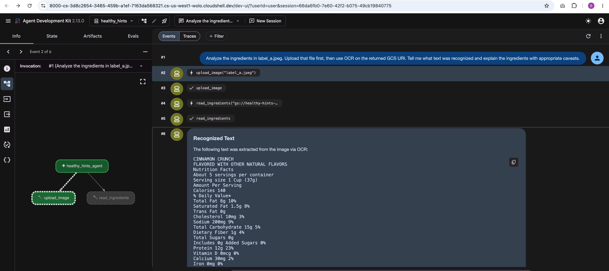

**2. `upload_image` returned this URI**

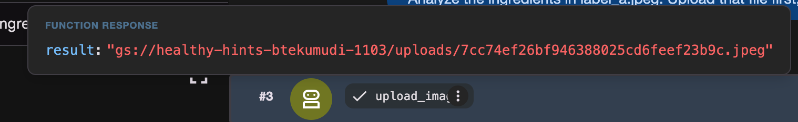

**3. `read_ingredients` received the same URI**

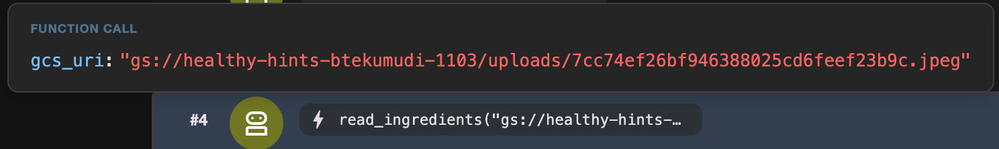

**4. Agent answer**

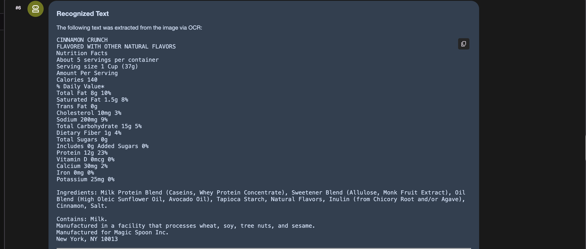
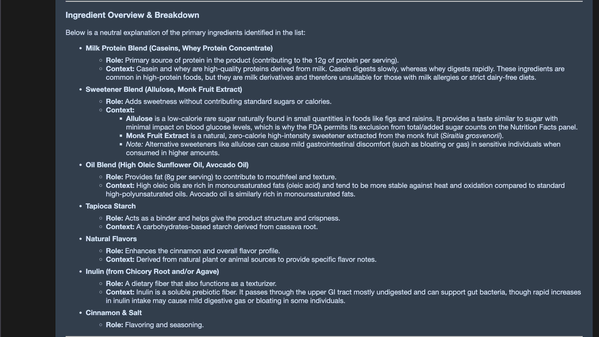
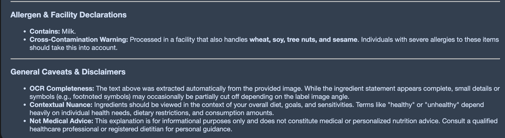

### label_b (chips)

**1. Event trace**

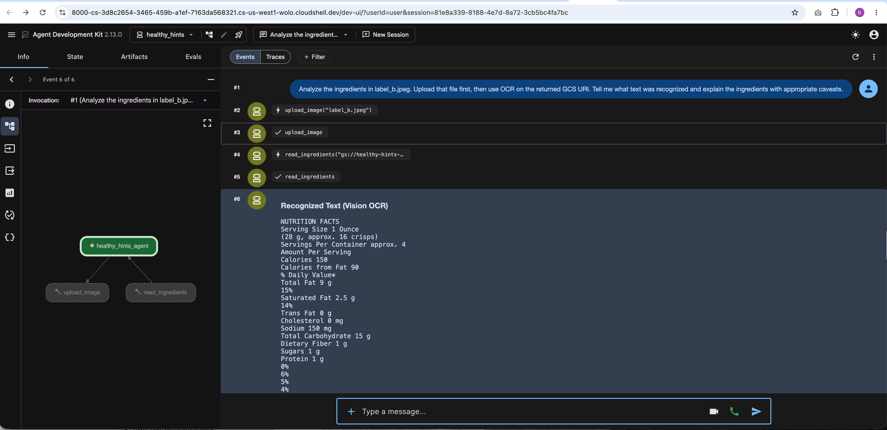

**2. `upload_image` returned a different URI**

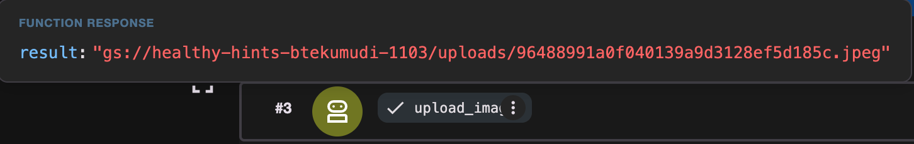

**3. `read_ingredients` received the same URI**

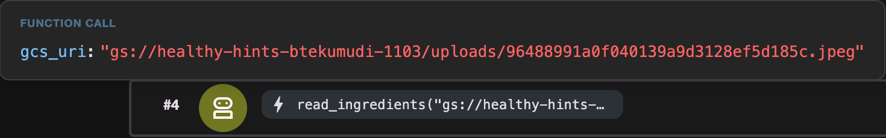

**4. Agent answer:** reports that the image has no ingredient list

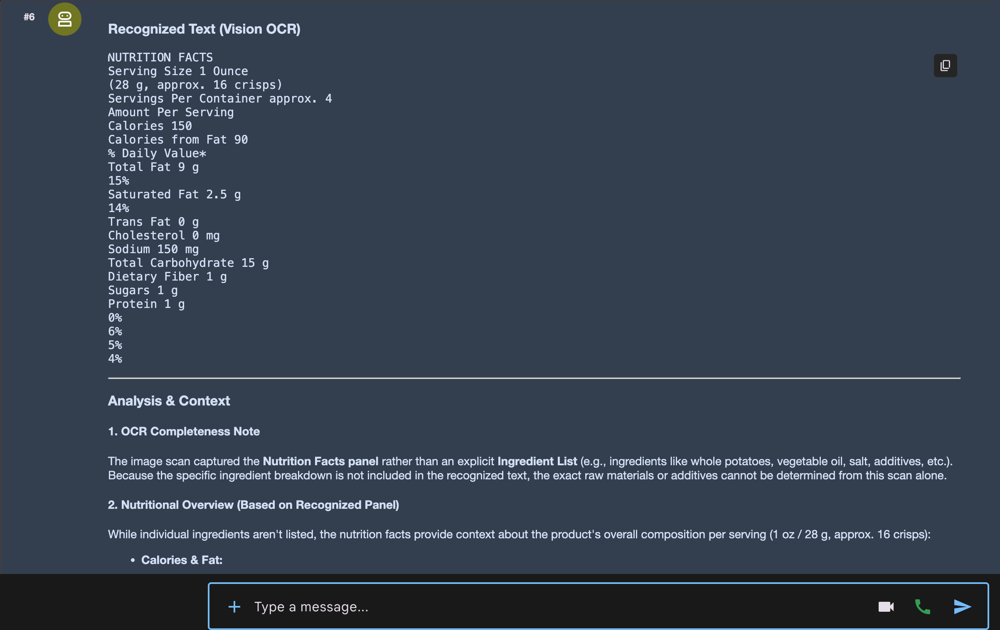
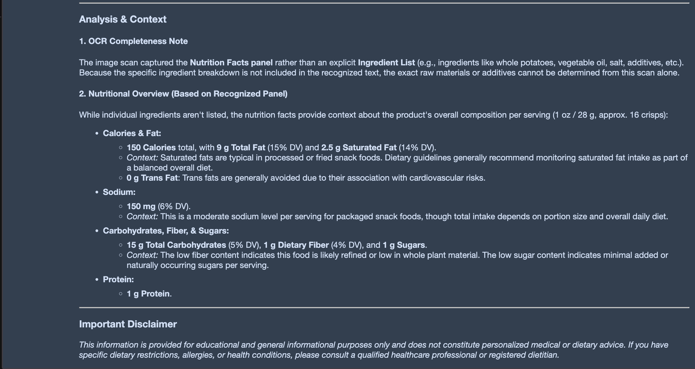

### What I observed

- **OCR is imperfect.** Vision read some zeros as the letter "O" (`Og`, `Omg`) and split the % Daily Value column away from its rows. Gemini quietly corrected these in its answer, which shows the LLM's output is not the same as the raw tool output.
- **Grounding mostly held.** With no ingredient list in label_b, the agent said ingredients could not be determined, though it still offered typical examples from general knowledge.
- **Test isolation matters.** Attaching the photo directly in chat lets the multimodal model see the image itself and bypass the tools, so all final runs used text-only prompts.

## Engineering notes

- **Input safety:** uploads are limited to one folder (path traversal check), to JPG/PNG/WebP, and to 8 MiB.
- **URI allow-list:** OCR only runs on URIs under the bucket's `uploads/` prefix.
- **Resilience:** the model is wrapped in `Gemini(...)` with retry options, so temporary `429` and `503` errors back off and retry instead of crashing.
- **No secrets in code:** the bucket and folder come from environment variables, and the API key stays in a git-ignored `.env`.
- **Layered testing:** `scripts/test_pipeline.py` calls the tools directly, which checks the cloud setup without spending model quota and separates cloud errors from agent errors.

## Project structure

```
adk-vision-ocr-agent/
├── healthy_hints/
│   ├── __init__.py
│   └── agent.py           # tools + agent definition
├── scripts/
│   └── test_pipeline.py   # direct tool test, no LLM
├── docs/
│   ├── BUILD_LOG.md       # step-by-step build notes and troubleshooting
│   └── screenshots/       # ADK trace screenshots
├── .env.example
├── requirements.txt
└── README.md
```

## Setup

**Prerequisites:** a Google Cloud project with billing enabled, and a Gemini API key from [Google AI Studio](https://aistudio.google.com/).

```bash
python -m venv .venv
source .venv/bin/activate
pip install -r requirements.txt

gcloud config set project YOUR_PROJECT_ID
gcloud services enable storage.googleapis.com vision.googleapis.com
gcloud storage buckets create gs://YOUR_BUCKET_NAME --location=us-west1

gcloud auth application-default login
gcloud auth application-default set-quota-project YOUR_PROJECT_ID
```

Copy `.env.example` to `healthy_hints/.env` and fill in your values. Put label images in `healthy_hints/images/`.

For the direct test script, also export the two settings in your shell:

```bash
export HEALTHY_HINTS_BUCKET=YOUR_BUCKET_NAME
export HEALTHY_HINTS_UPLOAD_DIR=$(pwd)/healthy_hints/images
```

Hit an error during setup? See [docs/BUILD_LOG.md](docs/BUILD_LOG.md) for every issue I ran into and how I fixed it.

## Run

```bash
# Check the cloud pipeline without the LLM
python scripts/test_pipeline.py label_a.jpeg label_b.jpeg

# Chat in the terminal
adk run healthy_hints

# Or use the web UI with tool traces
adk web --allow_origins="*"
```
## Testing

Unit tests mock Cloud Storage and Cloud Vision, so they run offline with no credentials:

```bash
pip install -r requirements-dev.txt
python -m pytest -v
```

18 tests cover path and file-type validation, size limits, unique upload names, the URI allow-list, OCR edge cases, and the core fix: OCR runs on exactly the URI the upload returned.
## Limitations

- Images must already be on the machine running ADK; there is no browser upload endpoint yet.
- File validation checks extension and size, not actual file contents.
- OCR can misread characters and lose table layout.
- Gives general information only, not personalized medical or nutrition advice.

## Tech stack

Python · Google ADK · Gemini · Google Cloud Storage · Cloud Vision API · Cloud Shell

## Credits

Based on Google's codelab [ADK: From Basics to Multi-Tool Agents](https://codelabs.developers.google.com/multi-tools-ai-agent-adk) (Apache 2.0). 
The corrected tool design follows the CS663 course extension lab.
