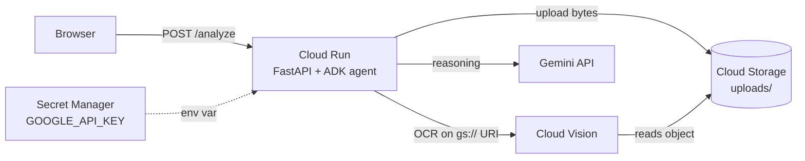

# Deploying to Cloud Run

The FastAPI service runs as a container on Cloud Run. The Gemini API key lives in Secret Manager, and the service runs as a dedicated service account with only the permissions it needs.



## 1. Variables

```bash
export PROJECT_ID=$(gcloud config get-value project)
export REGION=us-west1
export BUCKET=YOUR_BUCKET_NAME
export SERVICE=adk-vision-ocr-agent
export SA=healthy-hints-run
```

## 2. Enable the services

```bash
gcloud services enable run.googleapis.com cloudbuild.googleapis.com \
  artifactregistry.googleapis.com secretmanager.googleapis.com
```

## 3. Store the Gemini API key as a secret

```bash
printf "%s" "PASTE_YOUR_KEY" | gcloud secrets create gemini-api-key --data-file=-
```

`printf "%s"` avoids adding a trailing newline to the key.

## 4. Create a least-privilege service account

```bash
gcloud iam service-accounts create $SA --display-name="Healthy Hints Cloud Run"

# Upload images and let Vision read them, in this bucket only
gcloud storage buckets add-iam-policy-binding gs://$BUCKET \
  --member="serviceAccount:$SA@$PROJECT_ID.iam.gserviceaccount.com" \
  --role="roles/storage.objectCreator"
gcloud storage buckets add-iam-policy-binding gs://$BUCKET \
  --member="serviceAccount:$SA@$PROJECT_ID.iam.gserviceaccount.com" \
  --role="roles/storage.objectViewer"

# Read this one secret
gcloud secrets add-iam-policy-binding gemini-api-key \
  --member="serviceAccount:$SA@$PROJECT_ID.iam.gserviceaccount.com" \
  --role="roles/secretmanager.secretAccessor"
```

## 5. Auto-delete uploads after 7 days

```bash
cat > lifecycle.json << 'EOF'
{"rule": [{"action": {"type": "Delete"}, "condition": {"age": 7, "matchesPrefix": ["uploads/"]}}]}
EOF
gcloud storage buckets update gs://$BUCKET --lifecycle-file=lifecycle.json
rm lifecycle.json
```

## 6. Deploy

```bash
gcloud run deploy $SERVICE \
  --source . \
  --region $REGION \
  --service-account "$SA@$PROJECT_ID.iam.gserviceaccount.com" \
  --set-env-vars "HEALTHY_HINTS_BUCKET=$BUCKET,GOOGLE_GENAI_USE_VERTEXAI=0" \
  --set-secrets "GOOGLE_API_KEY=gemini-api-key:latest" \
  --memory 1Gi \
  --max-instances 1 \
  --allow-unauthenticated
```

`--source .` builds the `Dockerfile` with Cloud Build. `--max-instances 1` caps cost if the public URL gets traffic.

## 7. Test

```bash
URL=$(gcloud run services describe $SERVICE --region $REGION --format 'value(status.url)')
curl "$URL/health"
echo "$URL"
```

Open the URL in a browser and upload a label.

## Updating

After code changes, run the same `gcloud run deploy` command. Logs:

```bash
gcloud run services logs read $SERVICE --region $REGION --limit 50
```

## Taking it down

```bash
gcloud run services delete $SERVICE --region $REGION
```
